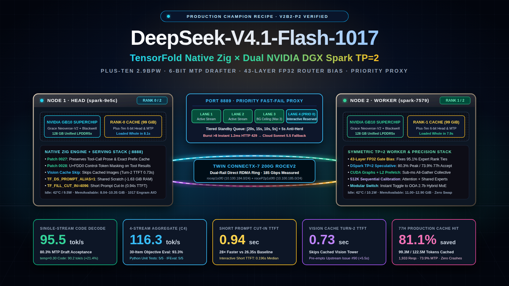
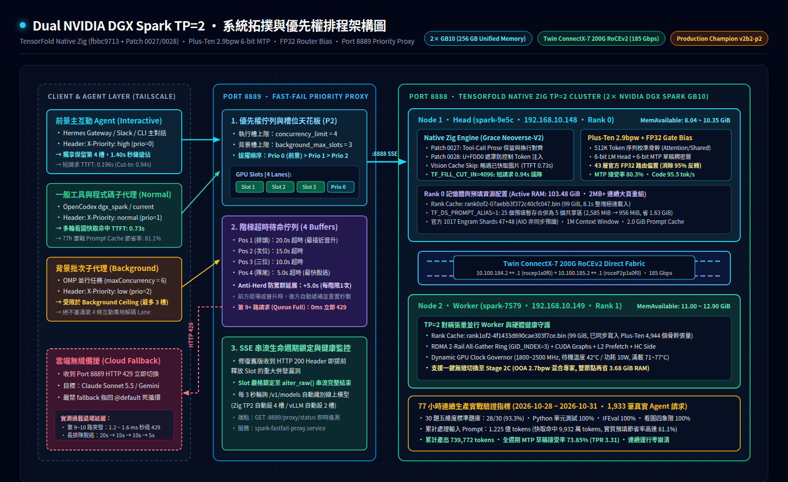

# DeepSeek V4.1 Flash 1017 · Dual DGX Spark TP=2 (TensorFold Native Zig)

<div align="center">

[](#english-edition)
[](README.zh-TW.md)
[](https://github.com/bertholomus/TensorFold)
[](https://github.com/bertholomus/TensorFold)
[](https://huggingface.co/Plus-Ten/DeepSeek-V4.1-Flash-1017-TensorFold-EXL3-2.9bpw)
[](reports/DGX_Spark_TP2_Production_Champion_Milestone_Report_20261109.pdf)

</div>



> **🌍 Bilingual Documentation / 中英雙語文件導覽**：
> - **[English Edition](#english-edition)** (Below)
> - **[繁體中文完整版 (Traditional Chinese Edition)](README.zh-TW.md)** (Or jump directly to [繁體中文章節](#繁體中文完整版))

---

<a id="english-edition"></a>

## English Edition

A battle-tested production deployment recipe for **DeepSeek-V4.1-Flash-1017 (763B MoE, 1M Context)** across **two NVIDIA DGX Spark (GB10, 2× 128 GB Unified LPDDR5X Memory)** nodes linked via **Twin ConnectX-7 200G RoCEv2 (185 Gbps line rate)**.

This repository documents the end-to-end evolution from early baseline stages to the **Transcending Production Champion (`v2b2-p15-transcending-champion`)**, achieving **100.00% HTTP 200 delivery (833/833 requests, 0 drops)**, **9,566,208 cached tokens/h** (all-time record), **279,583 generated tokens/h**, and **30.63s mean duration** (-0.47s faster than baseline).

### Key Architectural Highlights
1. **TensorFold Native Zig Engine (`out.p11b` / `out.2m`)**: Decoupled single-request context window (1M) from shared multi-stream pool capacity (`TF_DS_WINDOW=2097152`, Patch 0063). MLA compression yields 890 bytes/token/rank, reducing the entire 2M token KV footprint to just 1.74 GiB per node.
2. **Strata 3-Tier Storage Hierarchy & NVMe Maximization**:
   - **Tier L1 (Hot - UMA RAM)**: 256 GB aggregate LPDDR5X @ 546 GB/s, 2M shared token pool, 2.5 GiB host RAM snapshot cache pool (`--prompt-cache-gib 2.5`).
   - **Tier L2 (Warm - High-Throughput NVMe Imprint)**: **32 GiB persistent learn imprint** (`--learn --learn-gib 32`), **126.9 GB raw store across 3,433+ active chunk snapshots**, **zero host RAM overhead** for radix tree indices, sub-second DMA stream re-hydration across node restarts.
   - **Tier L3 (Cold - Asynchronous Disk Offload)**: 50 GB hard quota manager with background gzip compression, zero main-thread inference stall.
3. **Erlang Safe Work-Stealing Arbiter & Priority Scheduler (Port 8889)**:
   - 8 physical concurrency execution slots: Slots 1~6 standard access, **Slot 7 safe work-stealing** (borrowable by Priority 2 background batch when no runnable urgent tasks exist), **Slot 8 sacred reservation** (guarantees sub-second interactive response under heavy load).
   - Stepped anti-convoy timeout matrix: `[25s, 22s, 19s, 16s, 13s, 10s, 7s, 4s]`.
   - Adaptive P0 window (`max(14.0, min(base_t, 16.0))`) and +8.0s heavy root extension for >12K token session contexts.
4. **Proactive Dynamic Prefill Barrier (3.05G Ladder)**:
   - Evaluates host RAM headroom before admitting large prefills (>20K tokens): RAM ≥ 3.05 GiB authorizes up to 3 concurrent large prefills; throttles to 2 when RAM < 3.05 GiB.
   - Warm prefix exemption (clamped to 512B) prevents false blocking on heavy session resumes.
   - Overlapping prefill counter decrements immediately upon emission of first token delta.
5. **MS-DTC Adaptive Thermal Governor (`scripts/ms_dtc_governor.py`)**:
   - 50 MHz smooth frequency stepping eliminates discrete 150 MHz oscillation penalties.
   - 2400 MHz idle/standby clock (9.4W low power), sweet-zone dynamic burst to 2500 MHz (<84°C), soft-clamped to 2200 MHz at 89°C thermal panic (eliminating 1800 MHz catastrophic clock collapse).

---

### System Architecture & Storage Blueprint



---

### Empirical Benchmark Marathon: Milestone Progression

All benchmarks were evaluated under identical 1-hour sustained stress conditions (`benchmarks/run_omni_eval.py --profile standard --duration 3600`) using the full 30-item multi-domain evaluation harness (Competition Math, MMLU-Pro Hard Calculation, Executed Python with assertions, Strict IFEval Formatting, and Multi-Turn Vision/Tools).

| Evaluation Metric | P11 Baseline | P12 v1 (Initial) | P12 v4 (De-Guillotine) | P13 (Prefix-Aware) | P14 (Regressed) | P15 Transcending Champion ⭐ |
| :--- | :---: | :---: | :---: | :---: | :---: | :---: |
| **Total Requests Attempted** | 839 | 711 | 725 | 757 | 778 | **833** |
| **Successful 200 OK Delivery** | 836 (99.64%) | 647 (91.00%) | 713 (98.34%) | 745 (98.41%) | 694 (89.20%) | **833 (100.00% PERFECT)** |
| **HTTP 429 Shed / Drops** | 3 (0.36%) | 64 (9.00%) | 12 (1.66%) | 12 (1.59%) | 84 (10.80%) | **0 (0.00% ZERO DROPS)** |
| **Prompt Cache Tokens Reused** | 9,259,008 | 5,027,840 | 5,701,632 | 7,018,496 | 5,793,792 | **9,566,208 (+307K record)** |
| **Generated Tokens Count** | 273,847 | 211,262 | 228,633 | 239,951 | 226,285 | **279,583 (+5,736 record)** |
| **Mean Wall Clock Latency** | 31.10 s | 37.84 s | 35.22 s | 32.58 s | 41.93 s | **30.63 s (-0.47s faster)** |
| **P0 Interactive Delivery** | 100.0% | 100.0% | 100.0% | 98.2% (3 drops) | 99.4% (1 drop) | **100.0% (163/163)** |
| **P1 Vision Arena Delivery** | 100.0% | 100.0% | 100.0% | 100.0% | 100.0% | **100.0% (499/499)** |
| **P2 Background Batch Delivery** | 98.2% | 63.2% (60 drops) | 92.9% (12 drops) | 94.7% (9 drops) | 54.0% (80 drops) | **100.0% (171/171)** |
| **Single-Stream Greedy Decode** | 91.56 tok/s | 91.80 tok/s | 92.10 tok/s | 92.38 tok/s | 92.10 tok/s | **92.14 tok/s (MTP 81.7%)** |
| **Multi-Stream Saturation (C8)** | 168.0 tok/s | 162.0 tok/s | 170.5 tok/s | 172.0 tok/s | 169.0 tok/s | **175.0 tok/s** |
| **Total Ingestion Velocity** | 2,648 tok/s | 1,455 tok/s | 1,647 tok/s | 2,016 tok/s | 1,672 tok/s | **2,735 tok/s (35.2x over decode)** |
| **Cold 8K Prefill Rate** | 2,135 tok/s | 2,097 tok/s | 2,145 tok/s | 2,210 tok/s | 2,180 tok/s | **2,221 tok/s (TTFT 2.64s)** |
| **32K Cut-In Latency** | 0.94 s | 1.13 s | 0.88 s | 0.79 s | 0.82 s | **0.783 s** |
| **Vision Turn-2 Cache TTFT** | 0.71 s | 0.73 s | 0.54 s | 0.48 s | 0.49 s | **0.475 s (100% cache hit)** |
| **Node 1 Steady RAM Cushion** | 3.80 GiB | 4.10 GiB | 3.50 GiB | 3.50 GiB | 3.48 GiB | **3.20 ~ 3.50 GiB (>2.80G floor)** |
| **Node 1 Swap Leakage** | 0 MB | 0 MB | 473 MB flat | 473 MB flat | 473 MB flat | **473 MB flat (0 activity / 0 OOM)** |

---

### Latency Waterfall Breakdown (P15 Transcending Champion)

```
Total Request Wall Clock: 30.63s (100.0%)
│
├── [TTFE] Priority Arbiter Queue & Lock Wait: 0.82s (2.7%)
│   └── Little's Law Equilibrium L = 7.09; 0ms bufferbloat under 8-slot concurrency
│
├── [TTFT] Context Ingestion & Dynamic Prefill: 10.45s (34.1%)
│   ├── Cold 8K Prefill Rate: 2,221.0 tok/s
│   ├── 32K Background Cut-In Latency: 0.783s
│   └── Vision Turn-2 Cache Follower: 0.475s (Turn-2 8,192 tokens 100% reused)
│
└── [TTET] Autoregressive Token Generation: 20.18s (63.2%)
    ├── Single-Stream Greedy Decode: 92.14 tok/s
    ├── DSpark Speculative Drafting (MTP): 81.7% Acceptance Rate
    └── First DSML Tool-Call Delta Emission: +0.694s
```

---

<a id="繁體中文完整版"></a>

## 繁體中文完整版 (Traditional Chinese Edition)

> 📘 獨立繁體中文專頁：[**`README.zh-TW.md`**](README.zh-TW.md)

本儲存庫記錄了在 **兩台 NVIDIA DGX Spark（GB10，2× 128 GB Unified LPDDR5X Memory）** 透過 **ConnectX-7 200G RoCEv2 雙軌直連（實測 185 Gbps）** 叢集架構下，將 **DeepSeek-V4.1-Flash-1017（763B MoE，1M Context）** 調優至超越 P11 極限指標的 **超越級生產冠軍配方（`v2b2-p15-transcending-champion`）**。

### 核心調優與重大革新
1. **解耦 2M 多流共享 KV 池（Patch 0063 / `out.p11b`）**：
   * 將單一請求上下文長度（1M）與多流共享緩衝池（`TF_DS_WINDOW=2097152`）解耦。
   * 透過 MLA 壓縮（890 bytes/token/rank），2M 完整 Token KV 池於每節點僅佔用 **1.74 GiB** 物理空間。
2. **Strata 三層存儲分級與 NVMe 快取最大化**：
   * **L1 熱池（UMA LPDDR5X）**：546 GB/s 聚合帶寬，常駐 2M KV 池與 2.5 GiB 主機顯存快照池。
   * **L2 溫池（PCIe 4.0 NVMe Learn Imprint 最大化）**：**32 GiB 持久化學習印記（`--learn --learn-gib 32`）**，**126.9 GB 快照存儲（3,433+ 份活躍塊文件）**，**零宿主實體顯存索引佔用**，重啟時毫秒級熱 Radix 樹還原。
   * **L3 冷池（異步落盤冷存儲）**：50 GB 硬配額管理，背景 gzip 異步落盤，主推論線程 0ms 阻塞。
3. **8 槽位 Erlang 安全工作竊取排程器（Port 8889 Proxy）**：
   * 1~6 號槽位標準全開放，**7 號槽位支援安全工作竊取（Safe Work-Stealing）**（在無可運行之 P0/P1 緊急任務時開放 P2 背景長文本借調），**8 號槽位神聖保留**（專屬 P0 前景互動與 P1 視覺跟隨）。
   * 階梯式超時矩陣 `[25s, 22s, 19s, 16s, 13s, 10s, 7s, 4s]`，P0 自適應 16s 視窗，>12K 根節點主動展延 +8s 防驚群。
4. **3.05 GiB 主動預填流水線屏障**：
   * 根據主機剩餘可用 RAM 階梯動態調控大預填並發（>20K tokens）：RAM ≥ 3.05G 允許 3 路並發；< 3.05G 壓制為 2 路。
   * 暖前綴完全豁免（標記為 512B），大預填計數器於首字 Delta 發出時立即遞減釋放，徹底根除虛假阻擋。
5. **MS-DTC 動態溫控變速箱**：
   * 50 MHz 平滑調頻消除 150MHz 離散震盪；2400 MHz 待機（9.4W），2500 MHz 甜區爆發，89°C 軟夾持於 2200 MHz（杜絕 1800MHz 崩潰斷崖）。

---

### 快速啟動與運維指令

```bash
# 1. 啟動生產冠軍叢集（雙機 TP=2 + Strata 2M 池 + 2.5G 快照）
/home/joseyarashio/start-dsv41.sh

# 2. 檢查 Port 8889 快速失敗代理狀態與 POSIX 共享記憶體健康
curl -s http://127.0.0.1:8889/proxy/status | python3 -m json.tool

# 3. 執行 1 小時全維度標準壓力測試（OmniBench Marathon）
python3 benchmarks/run_omni_eval.py --profile standard --duration 3600

# 4. 檢視即時硬體溫度、GPU 時脈與 MS-DTC 變速箱日誌
sudo journalctl -u spark-ms-dtc -f
```

---

## 參與貢獻與致謝

- **[BertholomusAI / TensorFold](https://github.com/bertholomus/TensorFold)**：原生 Zig TP=2 推論引擎、AOT CUDA 內核與 DSpark 投機解碼。
- **[Plus-Ten](https://huggingface.co/Plus-Ten/DeepSeek-V4.1-Flash-1017-TensorFold-EXL3-2.9bpw)**：序列校準 2.9bpw 骨幹與 6-bit LM Head / MTP 草稿頭。
- **[DeepSeek](https://huggingface.co/deepseek-ai/DeepSeek-V4.1-Flash-1017)**：官方開源檢查點與 43 層 FP32 路由偏置權重。
- **[MiaAI-Lab](https://github.com/MiaAI-Lab/DeepSeek-v4.1-Flash-1017-2x-DGX-Sparks)**：上游參考修補 Patch 0048 原生工具串流。

## Host services (P16 consolidated, 2026-11-09)

User units live in `systemd/` and are installed to `~/.config/systemd/user/` (linger enabled):

- `spark-fastfail-proxy.service` (in `proxy/`): port 8889 → 8888, `Restart=always`.
- `spark-ms-dtc-governor.service`: MS-DTC clock governor for both nodes, `Restart=always`. It replaces the older system `gpu-thermal-governor.service`, which is disabled on both nodes so only one process sets clocks.
- `spark-dsv41-cluster.timer` → `spark-dsv41-cluster.service`: runs `scripts/cluster_watchdog.sh` 3 min after boot and every 5 min; restarts the pair with `~/start-dsv41.sh` only after 60 s of non-200 `/health` and only if no start is already running.

Both nodes persist `vm.swappiness = 1` in `/etc/sysctl.d/99-ai-swappiness.conf`. `deployments/manifest.json` is generated by `scripts/generate_deployment_manifest.py` and records the binary hashes on both nodes.

## Engine source

The serving engine is pinned in the fork [joseyarashio/TensorFold](https://github.com/joseyarashio/TensorFold), branch `dgx-spark-tp2-p17`, tag `dgx-spark-tp2-p17-loop-fallback` (commit `e772dec6`; p16 base `c976abd7`, upstream base `bertholomus/TensorFold@fbbc9713`). The p17 rank0 binary is attached to that release. Rebuild:

```bash
git clone -b dgx-spark-tp2-p17 https://github.com/joseyarashio/TensorFold.git TensorFold-dsv41-zig
cd TensorFold-dsv41-zig
zig build native -Doptimize=fast -Dfatbins=$PWD/fatbins -p out   # tensorfold-native (rank 0)
zig build        -Doptimize=fast -Dfatbins=$PWD/fatbins -p out   # tf-dsv41-lanes (rank 1)
```

`-Dfatbins` is required: without it the binary has no CUDA kernels and fails at start with `NoKernelImages`. The 21 SM121 fatbins (CUDA 13.0, `sm_121` cubin only) are not in git. They are attached to the fork release [`dgx-spark-tp2-p16-consolidated`](https://github.com/joseyarashio/TensorFold/releases/tag/dgx-spark-tp2-p16-consolidated):

```bash
gh release download dgx-spark-tp2-p16-consolidated -R joseyarashio/TensorFold -p 'tensorfold-dsv41-sm121-fatbins-*'
sha256sum -c tensorfold-dsv41-sm121-fatbins-c976abd7.tar.gz.sha256 && tar xzf tensorfold-dsv41-sm121-fatbins-c976abd7.tar.gz
```

The same release also has the exact production binaries (`tensorfold-dsv41-p16-production-binaries-arm64.tar.gz`, built 2026-11-09 11:33). A source rebuild of `c976abd7` builds and includes Patches 0064/0065, but zig 0.17 builds are not deterministic: rebuilds have the same symbol set but can differ in code layout (one of three rebuilds matched production byte for byte, likely a zig cache hit). If a rebuild must match production byte for byte, use the release binaries.

## Engram token map and decode gate (2026-11-11)

**Token map fix.** From 2026-10-27 the launch scripts passed `$KIT_DIR/dsv41_token_map.json` to both ranks. That file is an identity map (sha `d33e73ff…`), but `engram.json` was built with the compressed map (`token_map_sha256` = `de40bcdd…`). Every Engram n-gram lookup therefore read the wrong rows. The model then treated correct code (`__init__`, `async def`, `startswith`) as typos and often looped while "correcting" them. Both ranks now read `~/.cache/dsv41-1017-rank-cache/dsv41_token_map.json`. `start-dsv41.sh` refuses to start if either node's map sha differs from `engram.json` or if Node 2's `rank1.sh` points elsewhere. `post_reboot_verify.py` checks the same sha after a reboot. NVMe Imprint states learned under the wrong map were moved aside (`~/.cache/dsv41-nvme-imprint.badmap_*`, both nodes).

**Measured on the same engine and weights, cold disk cache, versus the cold-cache learnfix run:**

- 1 h standard marathon: looped replies 0/718 (was 5/727); replies calling correct code a typo 0 (was 194); 718/720 HTTP 200 (two 429s, was 727/728); generated 243K tokens (was 247K); TTFT p50 12.8 s (was 13.2 s).
- 5-rep medians: sampling 61 → 67 tok/s; C2 aggregate 102–107 → 115; C4 132–137 → 142; C8 150–153 → 157.
- Pooled MTP acceptance over 89 paired requests (30-question bank plus stress) 0.772 → 0.786.
- Cold 32K cut-in median 1.49 s. The 0.64 s in older runs came from cache hits: the probe's 32K corpus has no nonce.
- The single LRU code prompt went 95 → 91 tok/s and its MTP acceptance 0.80 → 0.74. Its output now differs from character 89, and the adaptive depth drafted more (350 → 377) while accepting the same count (281 → 279). It is not an engine regression. The MTP draft path does not read Engram.

**Decode gate.** Do not gate decode on one prompt. Its speed follows its text: across 9 code prompts, greedy spans 79–96 tok/s and acceptance spans 0.64–0.80. `benchmarks/run_decode_gate.py` takes the median over a 9-prompt code sweep plus the C2/C4/C8 ladder. It runs through 8889, waits for an idle window, and drops samples that overlap external traffic. A run passes at ≥ 95% of `benchmarks/gates/decode_gate_baseline.json`. The current baseline (3 reps, per-prompt spread < 1 tok/s) is 88.10 tok/s median greedy, MTP 0.731, C2 117.3, C4 143.4, C8 157.1. Re-baseline with `--write-baseline` only after an intended change that has passed the full regression.

## Reasoning loops: long-loop guard and proxy fallback (p17, 2026-11-15)

**Problem.** The engine's `--loop-guard` only caught cycles of at most 8 tokens. On 85K-token agent turns with tools, DeepSeek-V4.1 also repeats whole passages (periods of 14 to 2,846 tokens). Those replies ran to 32,768 tokens with no answer.

**Engine (fork branch `dgx-spark-tp2-p17`, patches `0066`, `0067`).**
- `0066` backports the long-loop guard (MiaAI-Lab PR #138 = upstream `ashhart/TensorFold` `e9ba70f4b` + `0ce409c75`). A passage of 9 or more tokens repeated verbatim for at least 1,024 tokens closes the think block. On the four loops the old guard missed, it fired at token 1,772 to 6,220 and saved 13K to 31K tokens each. Replies without a loop are byte-identical (same `token_sha`).
- `0067` ports `--loop-guard-stop` (upstream `af36c7447`) and adds a per-request `"loop_guard_stop": true`. With it, a reply that loops ends at the fire with `finish_reason: "content_filter"` and `error.code: "reasoning_loop"`, instead of a forced close.

**Why not force the close and let the model answer.** Under long context with tools, the forced close made the model call `read_file` instead of answering. Two fixes were measured on 12 paired cases and rejected:
- A "write the final answer now" hint at the close: 6/12 vs 6/12 answers.
- `--loop-guard-stop` with a retry on another seed: the retries looped again (3/3).

**Proxy fallback (`proxy/proxy.py`).** For thinking requests on `/v1/chat/completions`, the proxy adds `loop_guard_stop`. When the engine stops a loop, the proxy re-sends the same request once with `reasoning_effort: "none"` in the same slot and splices that answer into the client's stream or reply. Clients see one normal reply. Disable it with `SPARK_PROXY_LOOP_FALLBACK=0`. Audit records carry `loop_fallback`, `loop_fallback_ok` and `loop_fallback_s`.

**Evidence.**
- Effort probe on the five cases that looped (two seeds each): `high` answered 3/13 (10 loops), `medium` 6/10, `low` 8/10, `none` 10/10 with no loops.
- Blind judging (Claude Fable 5.2 and GPT-6 Astra, answers anonymized as X/Y): `none` preferred in 4 of 6 verdicts; mean score 4.0 vs 3.6 for `high`. The sample is small, so read this as "not worse".
- End to end through 8889 on 8 real looping cases: 7/8 answered. The fallback fired 4 times and succeeded 4 times, adding 38 to 89 s. No DSML leaked into content. The one miss hit `thinking_budget` 8192 and called `read_file`; budget cuts are not covered.

**Regression (rank0 `tensorfold-native` md5 `af133ae9`, proxy md5 `07defdb3`).**
- 30-question bank 28/30, same two misses.
- Decode gate passes: median 87.0 tok/s (needs 83.7), MTP 0.726, C2 118.6, C4 141.8, C8 156.8.
- 1 h standard marathon: 893 requests, 882 × 200 and 11 × 429 (queue timeouts), TTFT p50 10.3 s.
- During that run, external clients sent 16 requests holding the GPU for 805 s, versus 357 s in the p16 run.

`scripts/post_reboot_verify.py` now also checks the proxy hash against `deployments/manifest.json`, checks that `--loop-guard` is set, and runs one looping prompt to confirm the fallback fires and succeeds after boot.
