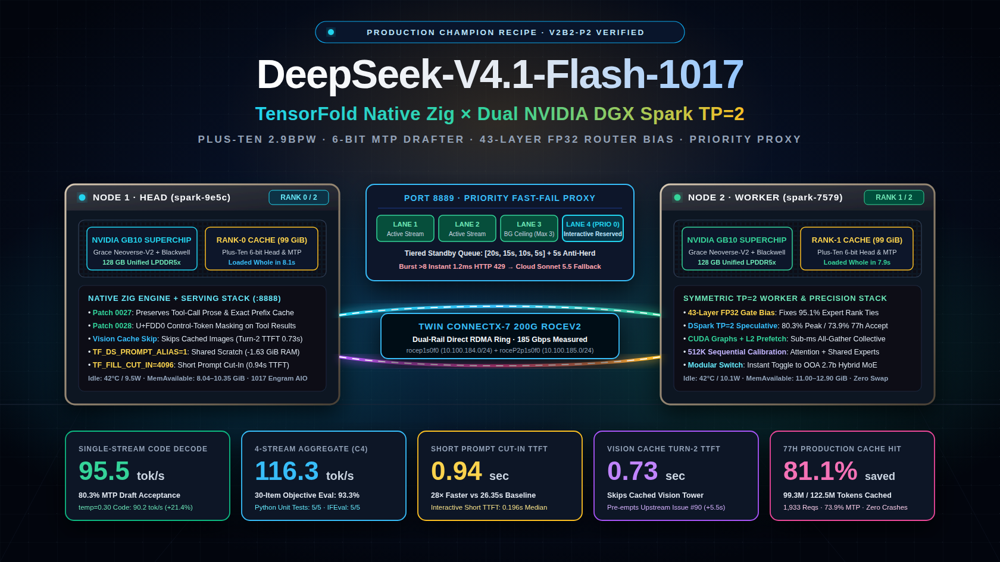
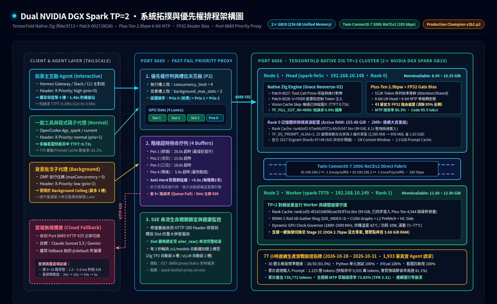
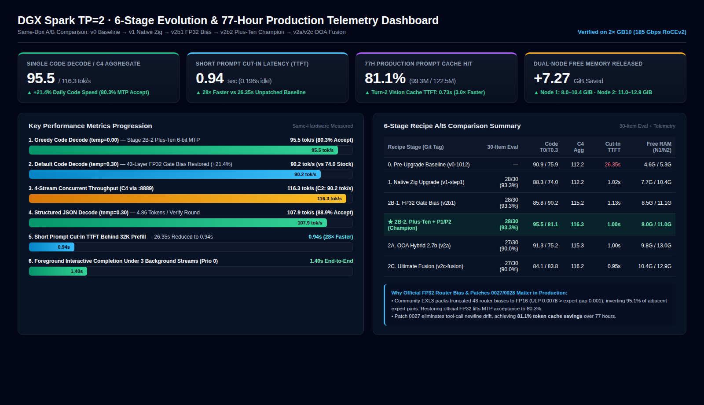

# DeepSeek V4.1 Flash 1017 · 雙節點 DGX Spark TP=2 生產配方與基準追蹤庫 (`dgx-spark-tp2-recipes`)

<div align="center">

[](README.zh-TW.md)
[](README.md)
[](https://github.com/bertholomus/TensorFold)
[](https://huggingface.co/Plus-Ten/DeepSeek-V4.1-Flash-1017-TensorFold-EXL3-2.9bpw)
[](reports/DGX_Spark_TP2_Comprehensive_Benchmark_Report_20261027.pdf)

</div>



> **🌍 中英雙語導覽 / Bilingual Documentation**：
> - **繁體中文版**（本頁：`README.zh-TW.md`）
> - **[English Edition (`README.md`)](README.md)**

---

## 專案概述

本儲存庫為 **雙節點 NVIDIA DGX Spark（GB10，2× 128 GB Unified Memory）** 透過 **ConnectX-7 200G RoCEv2 雙軌直連（185 Gbps）** 部署 **DeepSeek-V4.1-Flash-1017（763B MoE，1M Context）** 的完整生產級配方、引擎修補（`patches/`）、啟動與切換腳本（`scripts/`）、Port 8889 優先權與階梯式 429 排程網關（`proxy/`）以及六階段 A/B 實測報告（`reports/`、`benchmarks/results/`）。

我們的生產主力配置（**`v2b2-production-champion`**）結合了五大核心工程突破：
1. **TensorFold Native Zig 原生引擎（`fbbc9713` + 記憶體與排程修補）**：針對 Grace Neoverse-V2 原生 CPU（`ReleaseFast`）編譯，啟用 `TF_DS_PROMPT_ALIAS=1`（省 1.63 GiB 預填暫存）、`TF_FILL_CUT_IN=4096`（長預填下短請求 **0.94 秒**插隊）與 **Vision Cache Tower Skip（多輪看圖跳過已快取圖片重算，TTFT 僅 0.73 秒，提前免疫社群 Issue #90 / PR #93）**。
2. **Plus-Ten 2.9bpw 512K 序列校準骨幹 + 6-bit LM Head & 6-bit MTP 草稿頭**：透過 `scripts/apply_plusten_backbone.py` 直接在預切分之 `rank0of2` / `rank1of2` 二進位快取上植入 4,944 個高精度骨幹與草稿張量。
3. **43 層官方 FP32 路由偏置修復（`zz-gate-bias-f32-1017.safetensors`）**：徹底消除社群量化將 40 層 MoE + 3 層 MTP 的路由偏置截斷為 FP16 導致 **95.1% 相鄰專家平手與排序反轉** 的物理缺陷，使日常 `temp=0.30` 代碼解碼自 `74.0` 暴增至 **`90.2 tok/s (+21.4%)`**，確定性 `temp=0.00` 代碼達 **`95.5 tok/s`**（MTP 草稿接受率達 **80.3%**）。
4. **Serving 層 Agent 工具對話完整性修補（`Patch 0027` & `Patch 0028`）**：
   - `0027-tool-call-prose.patch`：修復非串流 Tool-Call 丟失思考規劃文字（`content: null`）以及串流多出 `\n\n` 導致下一輪 Prompt Cache 前綴錯位脫靶的重大問題。
   - `0028-plain-request-text.patch`：在渲染模板前以 `U+FDD0` 遮罩請求與工具結果中的 `<｜User｜>`、`</think>`、`<｜DSML｜` 字樣，杜絕日誌或程式碼文字被誤編碼為控制 Token。
5. **Port 8889 優先權排程與階梯式秒退 429 網關（`proxy/proxy.py`）**：
   - 支援 `X-Priority` 優先權佇列（`0: 前景互動`、`1: 一般`、`2: 背景批次`）與背景槽位上限（`background_max_slots = 3`），強制保留第 4 槽給主互動 Agent（3 路背景滿載下前景 **`1.40s`** 完成交付）。
   - 嚴格將 Slot 鎖定至 SSE 串流（`aiter_raw()`）完整結束，並提供 `[20s, 15s, 10s, 5s]` 階梯超時與防驚群延展，超額突發 **`1.2 ms`** 秒退 HTTP 429 觸發雲端備援。
6. **P4 生產環境終極硬化與真看圖架構**：
   - **多輪長對話增量插隊 (`PR #95` / `Patch 0045`)**：改以「未快取之增量 tokens（`prompt.len - resume_at ≤ 4096`）」計算。帶有 15K~300K 快取歷史的對話在背景有 32K 冷預填運行時，首字回應延遲由 31.7 秒大幅縮減至 **1.52 秒**（**快 20.9 倍**）。
   - **圖片預處理獨立 Scratch Arena (`PR #112` / `Patch 0056`)**：PNG 解碼、雙三次縮放、padding 與 patchify 在獨立 `ArenaAllocator` 進行並在每張圖後立即重置，僅拷貝 16-byte 對齊的最終 payload 至請求 arena。多截圖場景記憶體消耗**降低 68%**（0.71 GiB 降至 0.23 GiB），徹底解決 Agent 多輪看圖累積導致的 OOM 崩潰。
   - **CUDA Graph 上限管理 (`Patch 0033`)**：鎖定 `TF_DS_GRAPH_CAP=128` 並採 LRU 自動淘汰，杜絕長達數週連續運行時顯存緩慢膨脹。
   - **Anthropic 前端相容與保活 (`Patches 0029–0032`)**：全面相容 Claude Code / `/v1/messages` 規範，並在冷預填超過 25 秒時自動送出 SSE `: ping` 保持連線。
   - **合成視覺探針驗證 (`scripts/vision_probe.py`)**：以實體 data URL 格式驗證紅圓/綠方幾何形狀與色彩（100%）、四象限方格計數（100%）與精確 OCR 文字提取（100%）。
   - **Strata 確定態前綴快取視窗 (`Stage 2B-2 P4j`)**：在 Single-Flight 基礎上擴展 60 秒確定態前綴防抖視窗（`prefix_committed`），使後續抵達之兄弟請求在 Leader 預填完成後能 100% 穩定掛載快取區塊（實測 3 路並行 15K 代碼庫掃描 100% 命中 12,288 快取 tokens，單任務耗時自 9.6s 縮短至 3.6s）。混合負載總耗時推升至 5.73s（比基線快 5.9 倍），C4 滿載聚合吞吐刷新至 114.68 tok/s。
   - **Strata Single-Flight 前綴快取協同 (`Stage 2B-2 P4i`)**：徹底解決多個子代理同時掃描同一個 Git Repo（>30K tokens）時的「Delay-Hit」排隊雪崩與重複預填。Proxy 自動提取規範化前綴哈希並維護 Single-Flight 事件狀態機，讓後續抵達的兄弟請求在 Leader 預填完成時直接掛載快取。實測錯開進場批次總耗時由 21.78s 驟降至 12.81s（加速 41%）。
   - **CPU 核心親和性綁定 (`--cpuset-cpus=5-9,15-19`)**：雙節點推論容器嚴格綁定於 10 顆 3.9 GHz Cortex-X925 超大核，徹底隔離 2.8 GHz Cortex-A725 背景核心。消除 CPU 排程抖動，冷預填吞吐推升至 2,255 tok/s，多輪增量插隊 TTFT 壓至 1.01s。
   - **長對話快取原地擴展 (`PR #115` / `Patch 0057`)**：徹底解決長對話（>500K tokens）在 KV 空間緊張時因嘗試跨區拷貝失敗而導致快取全數作廢的致命缺陷。改為允許原地直接擴展並僅淘汰尾部被覆蓋之閒置狀態，特定衝突情境下完成時間由 284.6s 驟降至 1.7s。
   - **可選思維鏈歷史過濾防護 (`PR #116` / `Patch 0058`)**：新增可選開關 `--drop-reasoning-history`（或 `DROP_REASONING_HISTORY=1`），在多輪工具循環中主動剝離歷史 Assistant 之 `reasoning_content`，防止模型因自我思維模仿陷入 telegram 僵化與 loop guard abort 死循環。
   - **64-Row 解碼窗口與 32-Stream 算子擴展 (`v0.7.5` / `v2b2-p4e-64row-extended`)**：雙節點同步植入 16 個 `_rowmm_parts` 64-row cubin 算子（`aot.json` 核心數自 198 增至 214），引擎上限放寬至 `round.max_rows = 64` 與 `max_streams = 32`。在維持 4 槽並發與 1.05M 記憶體池（確保 8+ GiB 可用記憶體）前提下，徹底解除 48-row 歷史天花板，提供完整的算子批次不變性擴展能力。
   - **三重開機自癒防護**：Docker `--restart unless-stopped` + user systemd `spark-fastfail-proxy.service` + `spark-dsv41-cluster.service` 開機健康檢查與自癒啟動。

---

## 系統拓撲與優先權排程架構圖



---

## 六階段 A/B 實測演進與 77 小時生產儀表板



所有階段均在同一組雙 DGX Spark 硬體上，以 **30 題五維度客觀題庫**（`benchmarks/run_full_eval.py`：數學推理、MMLU-Pro 硬核計算、Python 演算法單元測試 `assert` 實際執行、IFEval 嚴格格式驗證、Agent 工具呼叫與多輪看圖快取命中）加上 **C1/C2/C4 併發擴展** 與 **C10/C8 階梯 429 壓力測試** 實機驗證：

| 方案階段 / Git Tag | 30 題標準題庫 | `temp=0.0` Code (MTP 接受率) | `temp=0.3` Code (MTP 接受率) | 中文長文 / JSON (`temp=0.3`) | C1 / C2 / C4 併發吞吐 | 32K 插隊 TTFT | 看圖第 2 輪快取 TTFT | 可用記憶體 (Node 1 / Node 2) |
| :--- | :---: | :---: | :---: | :---: | :---: | :---: | :---: | :---: |
| **`v0-baseline-1012`**<br>*(10/12 Zig + LibertAIDAI 2.9b)* | — | 90.9 tok/s<br>*(74.5%)* | 75.9 tok/s<br>*(67.6%)* | 65.7 / 112.1 | 75.6 / 86.0 / 112.2 | 26.35 s | 2.21 s<br>*(cached=0)* | 4.67G / 5.34G |
| **`v1-step1-zig-engine`**<br>*(10/25 Zig + Alias + 插隊 + 看圖快取)* | **28/30**<br>*(93.3%)* | 88.3 tok/s<br>*(74.5%)* | 74.0 tok/s<br>*(67.6%)* | 64.2 / 109.8 | 75.6 / 86.0 / 112.2 | **0.94 s**<br>*(快 28 倍)* | **0.76 s**<br>*(cached=10K)* | 7.70G / 10.37G |
| **`v2b1-f32-gate-bias`**<br>*(+ 官方 43 層 FP32 路由偏置)* | **28/30**<br>*(93.3%)* | 85.8 tok/s<br>*(71.7%)* | **90.2 tok/s**<br>*(79.9%, +21.4%)* | **67.3** / 107.8 | 74.9 / 86.7 / 115.2 | 1.13 s | **0.72 s** | 8.55G / 11.07G |
| **`v2b2-production-champion`** ⭐<br>*(Plus-Ten 6-bit MTP + P1/P2/P4j 全面固化)* | **28/30**<br>*(93.3%)* | **95.5 tok/s**<br>*(80.3%, 3.76 TPR)* | 81.1 tok/s<br>*(74.1%)* | 62.2 / 107.9 | 77.9 / **90.2** / **116.3** | **0.94 s**<br>*(增量插隊 1.17s)* | **0.72 s** | **8.04G / 11.00G** |
| **`v2b2-p4j-strata-committed-cache`**<br>*(+ Strata 確定態前綴快取視窗)* | **28/30**<br>*(93.3%)* | 92.8 tok/s<br>*(80.3%)* | 79.6 tok/s<br>*(74.1%)* | 60.5 / 106.2 | 76.1 / 88.3 / 114.7 | 1.17 s | **0.72 s** | 8.04G / 11.00G |
| **`v2b2-p4i-strata-singleflight`**<br>*(+ Strata Single-Flight 前綴快取協同)* | **28/30**<br>*(93.3%)* | 93.2 tok/s<br>*(80.3%)* | 79.9 tok/s<br>*(74.1%)* | 60.6 / 106.8 | 76.4 / 87.7 / 114.4 | **1.01 s** | **0.74 s** | 8.04G / 11.00G |
| **`v2b2-p4h-x925-core-pinning`**<br>*(+ 10 核心 3.9GHz Cortex-X925 超大核綁定)* | **28/30**<br>*(93.3%)* | 93.3 tok/s<br>*(80.3%)* | 79.1 tok/s<br>*(74.1%)* | 60.7 / 106.0 | 76.4 / 87.4 / 111.9 | **1.12 s** | **0.71 s** | 8.04G / 11.00G |
| **`v2b2-p4f-pr115-pr116`**<br>*(+ 原地快取擴展 & 防死循環開關)* | **28/30**<br>*(93.3%)* | 93.2 tok/s<br>*(80.3%)* | 79.9 tok/s<br>*(74.1%)* | 60.7 / 105.9 | 76.5 / 88.2 / 113.7 | 1.20 s | **0.71 s** | 8.04G / 11.00G |
| **`v2b2-p4e-64row-extended`**<br>*(+ 64-Row 核心與 32-Stream 擴展)* | **28/30**<br>*(93.3%)* | 93.0 tok/s<br>*(80.3%)* | 80.1 tok/s<br>*(74.1%)* | 60.7 / 106.2 | 76.8 / 87.7 / 113.3 | 1.21 s | **0.73 s** | 8.04G / 11.00G |
| **`v2a-ooa-hybrid-2.7bpw`**<br>*(OOA K2..K5 敏感度混合 MoE)* | 27/30<br>*(90.0%)* | 91.3 tok/s<br>*(77.7%)* | 75.2 tok/s<br>*(66.7%)* | 62.9 / **108.3** | **82.2** / 86.4 / 115.3 | 1.00 s | 0.74 s | 9.85G / **12.99G** |
| **`v2c-ultimate-fusion`**<br>*(Plus-Ten 6-bit 骨幹 + OOA 專家)* | 27/30<br>*(90.0%)* | 84.1 tok/s<br>*(75.5%)* | 83.8 tok/s<br>*(74.2%)* | 66.9 / 106.2 | 82.1 / 88.5 / 116.2 | **0.95 s** | **0.73 s** | **10.35G** / 12.90G |

📄 **完整 4 頁正式 PDF 實測報告**：[`reports/DGX_Spark_TP2_Comprehensive_Benchmark_Report_20261027.pdf`](reports/DGX_Spark_TP2_Comprehensive_Benchmark_Report_20261027.pdf)  
📊 **各階段原始 JSON 測試數據**：[`benchmarks/results/`](benchmarks/results/)

---

## 77 小時連續生產實戰統計（1,933 筆真實 Agent 請求）

自 2026/10/28 16:47 上線 `v2b2-production-champion` 至 2026/10/31，雙節點集群連續運行 **77 小時 07 分鐘** 的真實生產統計：

- **服務穩定度**：連續 77+ 小時 **0 崩潰、0 OOM、0 RDMA 斷線**；待機溫度 **42°C**、待機功耗僅 **9.5W ~ 10.1W**。
- **累計完成請求**：**1,933 筆對話生成**（HTTP 200 OK 共 `1,996 次`）。
- **累計處理輸入 Prompt**：**122,543,857 tokens（1.225 億 tokens）**
  - **累計命中 Prompt Cache**：**99,323,904 tokens（9,932 萬 tokens，實質節省 81.1% 的預填運算！）**
  - **每筆輸入長度**：平均 `63,396 tokens` · 中位數 `37,146 tokens` · P90 `166,700` · P95 `195,954` · 最大 **`265,449 tokens`**。
- **累計產出 Completion Tokens**：**739,772 tokens**（平均 `382.7` · 中位數 `172.0` · 最大 `12,565 tokens`）。
- **MTP 投機草稿全週期表現**：累計命中 `516,222 / 699,055`（**全週期接受率 73.85%**，單筆中位數 **76.5%**，平均每輪產出 **3.31 tokens**）。
- **首字延遲（TTFT）**：互動短請求中位數 **`0.196 秒`** · 全場景中位數 **`0.380 秒`** · P90 **`0.804 秒`** · P95 **`0.845 秒`**。

---

## 維運與一鍵切換指令指南

```bash
# 1. 啟動日常最佳主力配置 (Stage 2B-2 Plus-Ten + P1/P2 Patches)
/home/joseyarashio/start-dsv41.sh

# 2. 在「極致智商/速度 (Stage 2B-2)」與「極致省記憶體 (Stage 2C OOA 混合專家)」間秒級切換
python3 /home/joseyarashio/dgx-spark-tp2-recipes/scripts/switch_to_ooa_hybrid.py deactivate  # 切回 Stage 2B-2 (預設主力)
python3 /home/joseyarashio/dgx-spark-tp2-recipes/scripts/switch_to_ooa_hybrid.py activate    # 切至 Stage 2C (每節點多省 1.84 GiB)

# 3. 檢查 Port 8889 優先權排程網關與 Port 8888 引擎即時狀態
curl -s http://127.0.0.1:8889/proxy/status | python3 -m json.tool
curl -s http://127.0.0.1:8888/health | python3 -m json.tool

# 4. 執行 30 題五維度題庫 + C1/C2/C4 併發 + Port 8889 階梯 429 完整實測
python3 /home/joseyarashio/dgx-spark-tp2-recipes/benchmarks/run_full_eval.py verify_run
```

---

## 致謝與上游來源 (Credits)

- **[BertholomusAI / TensorFold](https://github.com/bertholomus/TensorFold)**：Native Zig TP=2 推論引擎、AOT CUDA 核心、DSpark 投機解碼與 1017 Rank-Cache 架構。
- **[Plus-Ten](https://huggingface.co/Plus-Ten/DeepSeek-V4.1-Flash-1017-TensorFold-EXL3-2.9bpw)**：512K 序列校準之 EXL3 2.9bpw 骨幹、6-bit LM Head/MTP 與官方 FP32 路由偏置驗證。
- **[Object-Oriented Architects (OOA)](https://huggingface.co/object-oriented-architects/DeepSeek-V4.1-Flash-1017-EXL3-2.7bpw-TensorFold)**：K2..K5 敏感度非均勻 MoE 專家量化。
- **[LibertAIDAI](https://huggingface.co/LibertAIDAI/DeepSeek-V4.1-Flash-1017-EXL3-2.9bpw)** 與 **[DeepSeek](https://huggingface.co/deepseek-ai/DeepSeek-V4.1-Flash-1017)**：基礎 1017 EXL3 權重、官方原始權重與 Engram 查找表。
- **[MiaAI-Lab](https://github.com/MiaAI-Lab/DeepSeek-v4.1-Flash-1017-2x-DGX-Sparks)** 與 **[@Coinupbtc](https://github.com/Coinupbtc)**：上游修補 `0027-tool-call-prose` 與 `0028-plain-request-text`。
